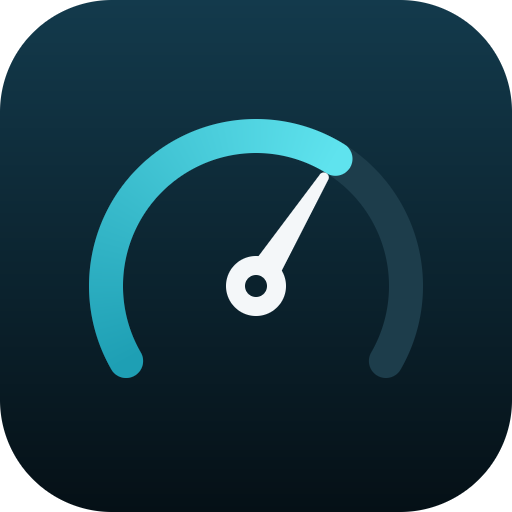
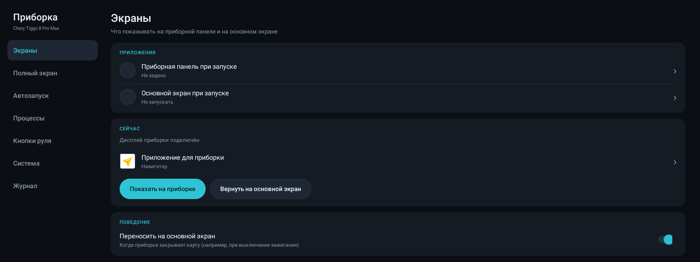
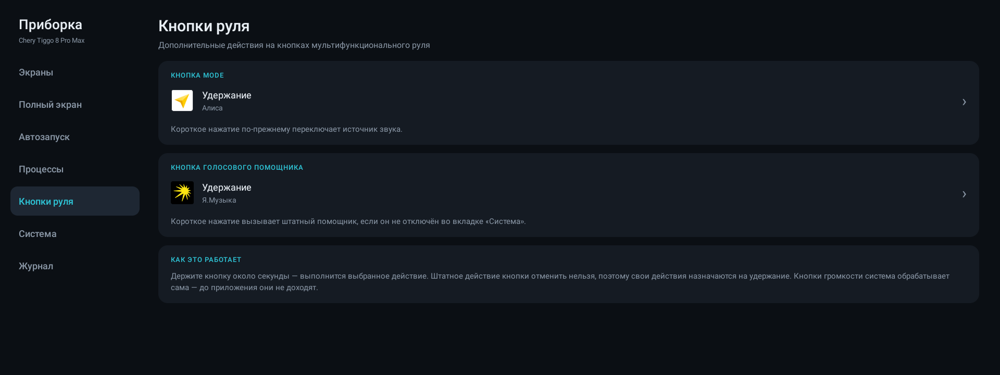
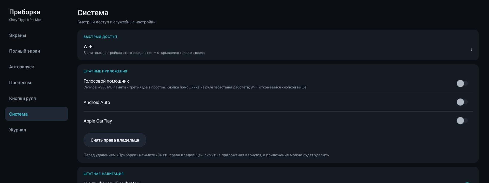
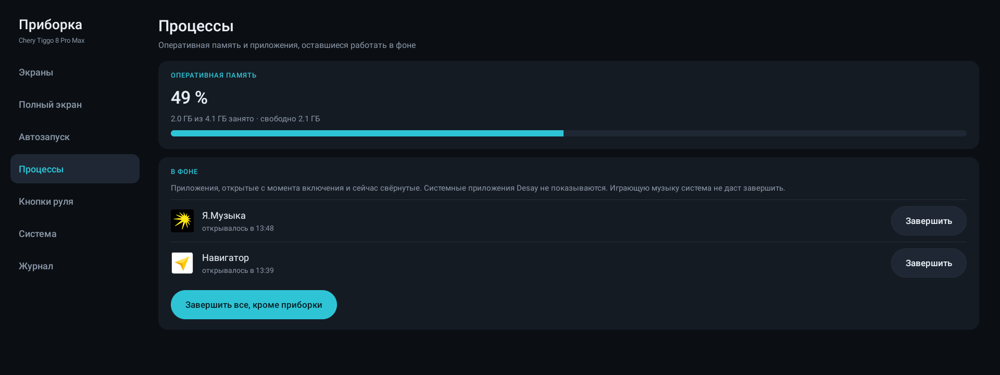
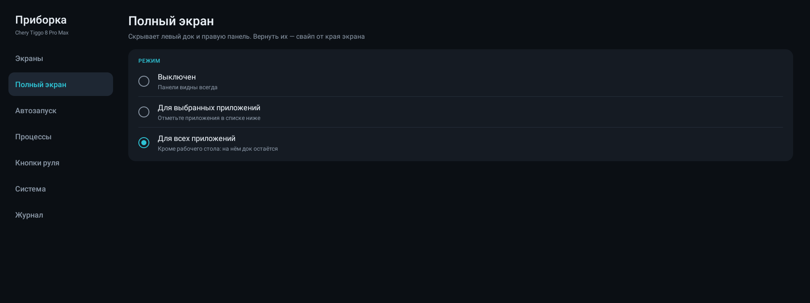
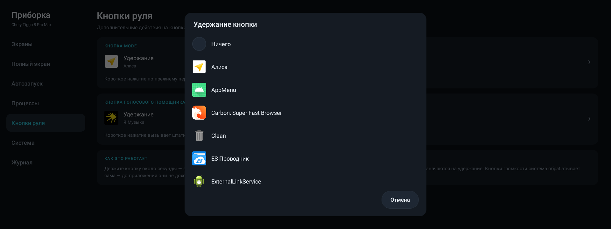

<p align="center"></p>

<h1 align="center">TiggoHelper</h1>

<p align="center">Помощник для мультимедиа Chery Tiggo 8 Pro Max: любое приложение на приборной панели,
автозапуск, кнопки руля, полноэкранный режим и отключение лишних штатных приложений.</p>

## Возможности

- **Приложение на приборной панели без TurboDog.** Яндекс Навигатор (или любое другое
  приложение) выводится на приборку сразу после включения — без штатной процедуры «запустить
  TurboDog и закрыть через меню». При выключении зажигания карта переезжает на основной экран,
  при включении возвращается.
- **Автозапуск** выбранных приложений после загрузки: фоновые (музыка и т. п.), основной экран,
  приборка.
- **Кнопки руля:** действие на удержание MODE и кнопки голосового помощника — Алиса в
  Яндекс Навигаторе или любое приложение. Короткие нажатия работают как раньше.
- **Полноэкранный режим:** скрытие левого дока и правой панели Desay для выбранных или всех
  приложений.
- **Процессы:** занятость оперативной памяти и завершение фоновых приложений.
- **Штатные приложения:** отключение голосового помощника Cerence (~380 МБ памяти и треть ядра
  процессора в простое), Android Auto и Apple CarPlay — и возврат их одним переключателем.
- **Wi-Fi:** быстрый вход в настройки Wi-Fi, которых нет в штатном меню.
- **Пустая приборка:** если приложение для приборки не выбрано, на ней не отражается основной экран.

## Скриншоты

| | |
|---|---|
|  |  |
|  |  |
|  |  |

## Совместимость

Проверено на Chery Tiggo 8 Pro Max с мультимедиа Desay SV (Renesas R-Car M3, Android 9),
прошивка `T1D_NV8401_03_41.30_230329`. На других прошивках и моделях Chery с похожей
мультимедиа может работать, но не проверялось.

> ⚠️ **Неофициальное приложение.** Не связано с Chery, Desay SV или Яндексом. Оно меняет системные
> настройки магнитолы (все изменения обратимы — см. «Удаление»). Используйте на свой риск и
> не настраивайте его на ходу.

## Установка

Нужен компьютер с [adb](https://developer.android.com/tools/releases/platform-tools) и доступ
к магнитоле по ADB (USB).

1. Скачайте из [Releases](../../releases) три файла в одну папку: `TiggoHelper-<версия>.apk`,
   `install.bat` (Windows) и `install.sh` (Linux/macOS). Или соберите APK сами (см. «Сборка»).
2. Подключите магнитолу по USB и запустите установку:
   - **Windows:** двойной щелчок по `install.bat`. `adb.exe` должен быть в `PATH` или лежать
     в той же папке (вместе с `AdbWinApi.dll` и `AdbWinUsbApi.dll` из platform-tools).
   - **Linux/macOS:**
     ```bash
     ./install.sh
     ```
   Без аргумента скрипт берёт APK из своей папки; путь можно указать явно:
   `install.bat путь\к\TiggoHelper.apk` или `./install.sh путь/к/TiggoHelper.apk`.

   Скрипт ставит APK, выдаёт разрешения (`WRITE_SECURE_SETTINGS`, доступ к статистике
   использования), включает accessibility-сервис автозапуска и открывает приложение.
   Просто установить APK недостаточно — без скрипта не заработают автозапуск, полноэкранный
   режим и список процессов.
3. **Отключение штатных приложений** (необязательно). Приложение должно стать владельцем
   устройства, а Android разрешает это, только пока на магнитоле нет учётных записей.
   Учётные записи Яндекса можно временно «спрятать», отключив их приложения:
   ```bash
   adb shell pm disable-user --user 0 ru.yandex.yandexnavi
   adb shell pm disable-user --user 0 ru.yandex.music
   adb shell dpm set-device-owner ru.tiggo.cluster/.AdminReceiver
   adb shell pm enable ru.yandex.yandexnavi
   adb shell pm enable ru.yandex.music
   ```
   Проверьте `adb shell dumpsys account` — если остались другие учётные записи, отключите и их
   приложения тем же способом.
4. Если TurboDog рисует свою карту поверх выбранного приложения, отключите его:
   ```bash
   adb shell pm disable-user --user 0 com.astrob.turbodog
   ```

## Удаление

1. В приложении: **Система → «Снять права владельца»** (если назначали) — скрытые
   приложения вернутся.
2. `adb uninstall ru.tiggo.cluster`
3. По желанию вернуть остальное:
   ```bash
   adb shell pm enable com.astrob.turbodog
   adb shell settings delete global policy_control
   adb shell setprop persist.sys.start.natp 1
   ```

## Сборка

Gradle не нужен: `build.sh` собирает APK напрямую через `aapt2`, `javac`, `d8` и `apksigner`.

Требуется JDK 17+ и Android SDK с компонентами `build-tools;34.0.0`, `platforms;android-28`
и `cmdline-tools;latest`.

```bash
ANDROID_SDK=~/Android/Sdk JAVA_HOME=/usr/lib/jvm/java-21 ./build.sh
```

Результат — `build/TiggoHelper.apk`. Ключ подписи `debug.keystore` создаётся при первой
сборке; обновлять установленное приложение можно только APK с тем же ключом.

Файлы для релиза (`TiggoHelper-<версия>.apk`, `install.sh`, `install.bat`) собирает
`./make_release.sh` в папку `release/`.

Для WSL, где магнитола видна только Windows-версии `adb.exe`, скопируйте
`local.env.example` в `local.env` и укажите пути — `install.sh` подхватит их.

Иконка рисуется скриптом `tools/make_icon.py` (только стандартная библиотека Python).

## Как это устроено

Подробно — в [docs/HOW-IT-WORKS.md](docs/HOW-IT-WORKS.md): как приборка решает, что
показывать, почему не работает обычный автозапуск, как приходят кнопки руля и чего на Android 9
сделать нельзя.
